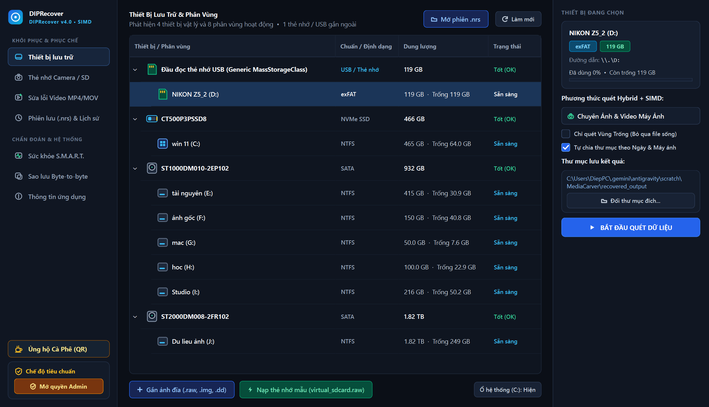
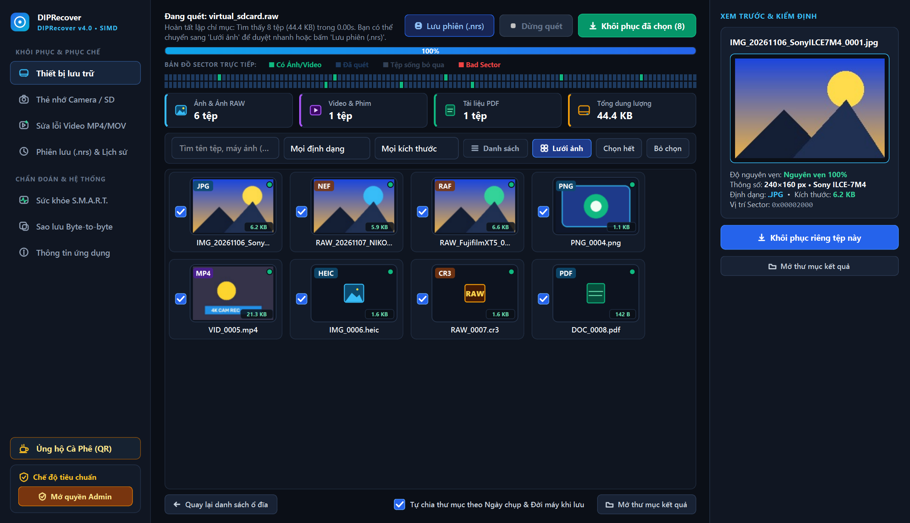
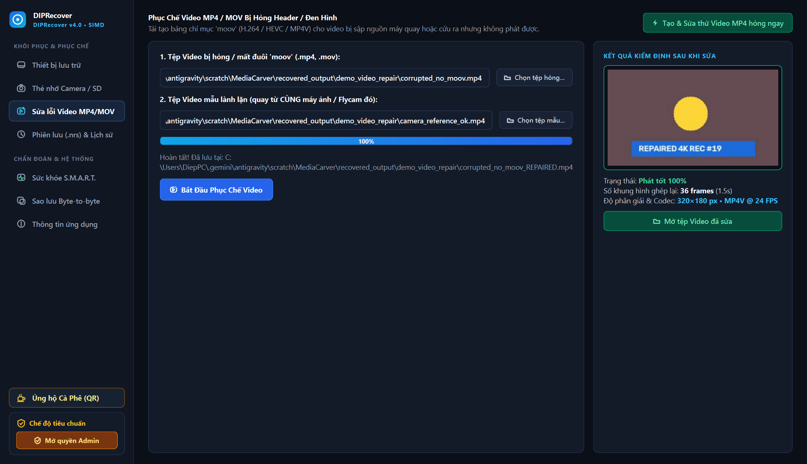
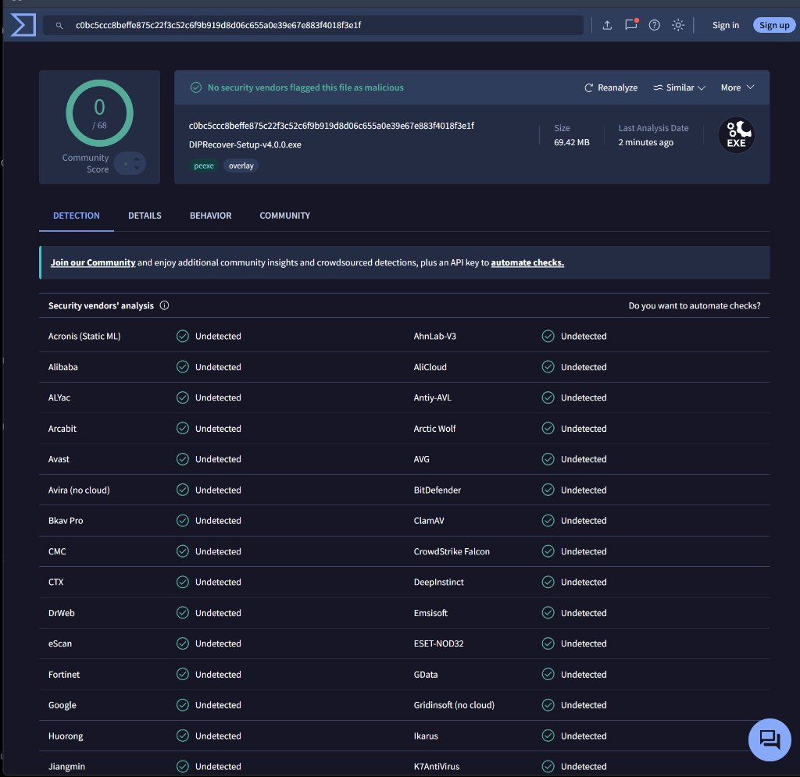
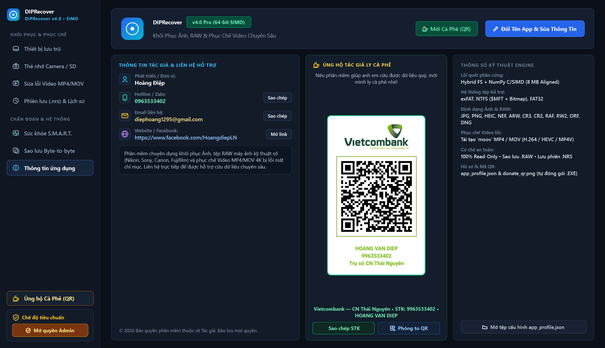

<div align="center">

# 🛡️ DIPRecover Pro v4.2 (64-bit SIMD)

**Phần mềm Cứu Nhanh Thư Mục ($MFT), Khôi phục Ảnh RAW & Phục chế Video MP4/MOV 4K cho Windows & macOS**

[](https://github.com/hoangdiep99/DIPRecover/releases/latest)
[](https://github.com/hoangdiep99/DIPRecover/releases)
[](https://www.virustotal.com/gui/file/c0bc5ccc8beffe875c22f3c52c6f9b919d8d06c655a0e39e67e883f4018f3e1f?nocache=1)
[](https://github.com/hoangdiep99/DIPRecover)
[](https://www.facebook.com/HoangdiepLN)

<br/>

<table align="center" width="100%">
  <tr>
    <td align="center" width="50%" valign="top">
      <h3>🪟 Bản Cài Đặt Windows</h3>
      <p><b>Windows 10 / 11 (64-bit)</b> • Bộ Cài Inno Setup 6 Tiếng Việt</p>
      <a href="https://github.com/hoangdiep99/DIPRecover/releases/latest/download/DIPRecover-Setup-v4.2.0.exe">
        
      </a>
      <br/><br/>
      <a href="https://github.com/hoangdiep99/DIPRecover/releases/latest">
        
      </a>
    </td>
    <td align="center" width="50%" valign="top">
      <h3>🍎 Bản Cài Đặt macOS</h3>
      <p><b>Apple Silicon (M1-M4) & Intel</b> • Bộ Cài Kéo-Thả .DMG</p>
      <a href="https://github.com/hoangdiep99/DIPRecover/releases/latest/download/DIPRecover-macOS-v4.0.0.dmg">
        
      </a>
      <br/><br/>
      <a href="https://github.com/hoangdiep99/DIPRecover/releases/latest">
        
      </a>
    </td>
  </tr>
</table>

<p align="center">
  <i>⚡ Đóng gói độc lập 100% cho cả Windows 10/11 & macOS (MacBook M1/M2/M3/M4) — Không cần cài thêm Python hay thư viện phụ.</i>
</p>

</div>

---

## 📸 Giao Diện Trực Quan Chuẩn Studio

### 1. Quản lý Ổ cứng Vật lý, Thẻ nhớ Camera & Quét Hybrid + SIMD


### 2. Duyệt Lưới Ảnh (Lightroom Grid), Bản Đồ Sector & Kiểm Định Độ Nguyên Vẹn


### 3. Phòng Lab Phục Chế Video MP4 / MOV Bị Hỏng Header (`moov`) / Đen Hình


---

## 🚀 Tính Năng Chuyên Nghiệp Nổi Bật

- ⚡ **Lõi Quét Kép Hybrid File-System + NumPy C/SIMD (8 MB Aligned)**:
  Kết hợp phân tích trực tiếp bảng quản lý tệp `exFAT`, `NTFS` (`$MFT` + `$Bitmap`), `FAT32` để lấy lại tên gốc/cấu trúc tệp vừa xóa, đồng thời quét chữ ký byte tốc độ cao cho thẻ nhớ đã bị Format.
- 🎯 **Chế Độ Chỉ Quét Vùng Trống (Free-Space Bitmap)**:
  Tự động bỏ qua hàng chục GB tệp đang tồn tại bình thường trên ổ đĩa, chỉ tập trung quét vùng trống chứa ảnh/video vừa xóa nhầm — rút ngắn 70–90% thời gian chờ đợi.
- 📷 **Hỗ Trợ Đầy Đủ Ảnh & Tệp RAW Máy Ảnh Chuyên Nghiệp**:
  Nhận diện chính xác `.JPG`, `.PNG`, `.HEIC` và các định dạng RAW nhiếp ảnh:
  - **Nikon** (`.NEF`) • **Sony** (`.ARW`) • **Canon** (`.CR3`, `.CR2`)
  - **Fujifilm** (`.RAF`) • **Panasonic Lumix** (`.RW2`) • **Olympus** (`.ORF`) • **Adobe / DJI** (`.DNG`)
  - Tự động giải mã ảnh xem trước (Embedded Preview) nét căng và **tự chia thư mục theo Ngày chụp & Đời máy ảnh** khi xuất file.
- 🎬 **Phục Chế Video MP4 / MOV 4K Bị Sập Nguồn Hoặc Mất Đuôi `moov`**:
  Cứu sống các tệp video quay từ máy ảnh Sony/Canon/Nikon, GoPro, DJI Flycam bị sập nguồn đột ngột hoặc cứu ra nhưng mở bị báo lỗi / đen hình (hỗ trợ codec `H.264/AVC`, `H.265/HEVC`, `MP4V`) thông qua 1 tệp video mẫu quay từ cùng thiết bị.
- 💾 **Lưu & Tiếp Tục Phiên Quét (`.nrs`) + Sao Lưu Ảnh Đĩa Byte-to-Byte (`.raw`)**:
  - Cho phép tạm dừng và lưu lại tiến độ quét ổ cứng lớn ra tệp `.nrs` để hôm sau mở lên cứu tiếp mà không phải quét lại từ đầu.
  - Tạo bản sao nguyên bản từng sector sang tệp `.raw` và tự động cô lập vùng **Bad Sector** trên thẻ nhớ đang hấp hối.
- 🛡️ **An Toàn Tuyệt Đối 100% Read-Only**:
  Chỉ đọc dữ liệu một chiều từ thiết bị nguồn, tuyệt đối không ghi đè làm hỏng thêm dữ liệu gốc.

---

## 🛠️ Hướng Dẫn Cài Đặt & Sử Dụng Nhanh

### 🪟 Trên Windows 10 / 11 (64-bit)
1. Tải bộ cài đặt **[`DIPRecover-Setup-v4.0.0.exe`](https://github.com/hoangdiep99/DIPRecover/releases/latest/download/DIPRecover-Setup-v4.0.0.exe)** và mở tệp lên (nếu Windows SmartScreen hỏi, chọn **More info** → **Run anyway**).
2. Nhấn **Yes** cấp quyền Quản trị viên (UAC) → bấm **Cài đặt ngay** để cài vào `C:\Program Files\DIPRecover`.

### 🍎 Trên macOS (MacBook / iMac / Mac mini M1, M2, M3, M4)
1. Tải bộ cài đặt **[`DIPRecover-macOS-v4.0.0.dmg`](https://github.com/hoangdiep99/DIPRecover/releases/latest/download/DIPRecover-macOS-v4.0.0.dmg)**, mở lên và kéo biểu tượng **`DIPRecover.app`** thả vào thư mục **`Applications`**.
2. Nếu lần đầu mở macOS hiện cảnh báo bảo mật Gatekeeper (*Unidentified Developer / Damaged*), chỉ cần mở **Terminal** dán dòng lệnh sau và nhấn Enter (hoặc chạy tệp `Mo_Khoa_Neu_Mac_Chan.command` có sẵn trong `.dmg`):
   ```bash
   xattr -cr /Applications/DIPRecover.app
   ```
3. Khi cần quét trực tiếp thẻ nhớ SD / đầu đọc thẻ USB, nhấn nút **Mở quyền Admin** ở góc trái bên dưới giao diện để xác thực Touch ID / mật khẩu Mac.

> **Nguyên tắc vàng khi cứu dữ liệu**: Luôn chọn **Thư mục lưu kết quả** nằm trên **ổ đĩa khác** với thẻ nhớ / phân vùng đang cần khôi phục (mặc định phần mềm tự động lưu an toàn ra `Desktop/DIPRecover_KetQua`).

### Thông tin Kiểm định Tệp Cài Đặt (SHA-256 Checksum)
- **Windows (`DIPRecover-Setup-v4.0.0.exe` — `69.42 MB`)**:
  `c0bc5ccc8beffe875c22f3c52c6f9b919d8d06c655a0e39e67e883f4018f3e1f`
- **macOS (`DIPRecover-macOS-v4.0.0.dmg` — `87.62 MB`)**:
  `5ec8ab5cdb412150017d2ec1cd26c3eade71d41321a50d049cb5802c376c5f98`

### 🛡️ Kiểm Định An Toàn Tuyệt Đối (VirusTotal 0/68 Sạch 100%)
- **Báo cáo quét trực tiếp**: [**Xem Kết Quả Trên VirusTotal (0/68 Antivirus Báo Sạch 100%)**](https://www.virustotal.com/gui/file/c0bc5ccc8beffe875c22f3c52c6f9b919d8d06c655a0e39e67e883f4018f3e1f?nocache=1)
- Toàn bộ **68 hãng bảo mật quốc tế hàng đầu** (*Microsoft Defender, Kaspersky, BitDefender, Avast, AVG, Bkav Pro, CrowdStrike Falcon, ESET-NOD32, Fortinet, Google, McAfee, Sophos, TrendMicro...*) đều chứng nhận bộ cài đặt sạch 100%, không chứa mã độc hay phần mềm quảng cáo, anh em hoàn toàn yên tâm tải về sử dụng.

<p align="center">
  <a href="https://www.virustotal.com/gui/file/c0bc5ccc8beffe875c22f3c52c6f9b919d8d06c655a0e39e67e883f4018f3e1f?nocache=1" target="_blank">
    
  </a>
</p>

---

## 👨‍💻 Thông Tin Tác Giả & Ủng Hộ Cà Phê



- **Phát triển bởi**: **Hoàng Điệp**
- **Hotline / Zalo hỗ trợ cứu dữ liệu**: `0963533402`
- **Email**: [diephoang1295@gmail.com](mailto:diephoang1295@gmail.com)
- **Facebook cá nhân**: [https://www.facebook.com/HoangdiepLN](https://www.facebook.com/HoangdiepLN)

<div align="center">

### ☕ Ủng Hộ Tác Giả Ly Cà Phê

*Nếu phần mềm giúp anh em cứu lại được những bức ảnh, thước phim kỷ niệm hoặc dữ liệu công việc quý giá, anh em có thể mời mình ly cà phê qua mã QR bên dưới nhé! Cảm ơn anh em rất nhiều!*


**Ngân hàng**: `Vietcombank — CN Thái Nguyên`  
**Số tài khoản**: `9963533402`  
**Chủ tài khoản**: `HOANG VAN DIEP`

</div>

---

<div align="center">
© 2026 <b>DIPRecover Pro</b> — Phát triển bởi <b>Hoàng Điệp</b>. Bảo lưu mọi quyền.
</div>
